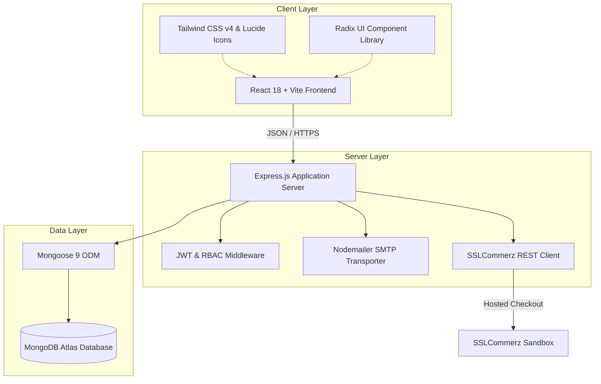
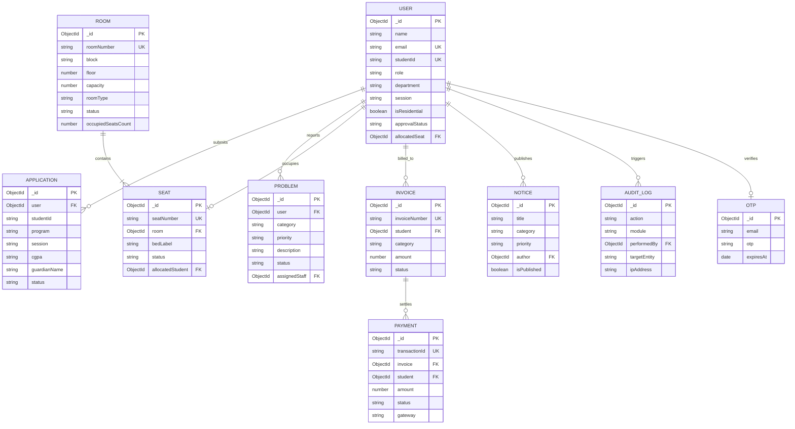
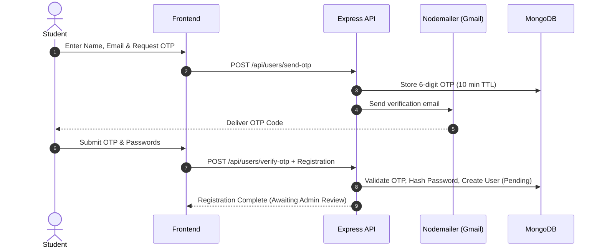

# Comprehensive Project Report
# Shadhinota Hall Management System
**Pabna University of Science and Technology (PUST), Bangladesh**

---

## 1. Executive Summary

The **Shadhinota Hall Management System** is an institutional full-stack enterprise web application developed for **Pabna University of Science and Technology (PUST)**. The system modernizes and automates residential student operations, room and bed inventory tracking, student identity and role verification (with 6-digit email OTPs), maintenance ticket lifecycles, official circular publishing, administrative audit logging, and digital payment collection via the **SSLCommerz Sandbox** gateway.

Prior to this solution, university dormitories were governed through disparate paper registers, manual cash transactions, and untracked maintenance notices. This project delivers a high-concurrency, auditable digital platform engineered using the **MERN stack** (MongoDB, Express.js, React 18 with Vite, and Node.js) paired with Tailwind CSS and Radix UI primitives.

```
       +-----------------------------------------------------------+
       |            PUST Institutional Web Portal (React)          |
       +-----------------------------+-----------------------------+
                                     |  REST API & JWT
                                     v
       +-----------------------------------------------------------+
       |                Node.js & Express API Gateway              |
       |  (Auth, Users, Applications, Rooms/Seats, Payments, etc.) |
       +--------------+-----------------------------+--------------+
                      |                             |
       +--------------v--------------+ +------------v--------------+
       |   MongoDB Atlas Database    | |   External Microservices  |
       |  (Users, Seats, Invoices..) | | (SSLCommerz, Nodemailer)  |
       +-----------------------------+ +---------------------------+
```

---

## 2. Problem Statement & Motivation

Residential halls in public universities in Bangladesh face operational bottlenecks that hamper student welfare and administrative transparency:

1. **Labor-Intensive Bed Allocation**: Physical paperwork leads to manual errors, prolonged processing times during admissions, and accidental double-booking of beds.
2. **Untracked Fee Collections & Reconciliation**: Cash handovers for seat allocation fees, semester charges, and renewal fees result in reconciliation discrepancies, missing paper slips, and delayed accounting.
3. **Delayed Maintenance Response**: Plumbing, electrical, carpentry, and Wi-Fi outages reported verbally or in physical logbooks are frequently overlooked without accountability.
4. **Lack of Centralized Resident Verification**: Hall authorities, provosts, and security staff lack real-time digital verification tools to confirm whether a student on campus premises is residential or non-residential.
5. **Unauthorized Account Registrations**: Open registration systems risk privilege escalation where unauthorized students could register as staff or administrators.

---

## 3. Project Objectives & Scope

### 3.1 Primary Objectives
- **Digital Residency Pipeline**: Facilitate online seat applications, prerequisite CGPA/academic data submission, and automated administrative approval workflows.
- **Granular Room & Bed Hierarchy**: Manage physical infrastructure down to Block $\rightarrow$ Floor $\rightarrow$ Room $\rightarrow$ Individual Bed (A, B, C, D).
- **Integrated Payment Gateway**: Deploy SSLCommerz Sandbox integration supporting major Bangladeshi payment channels (bKash, Nagad, Rocket, Visa/Mastercard/Amex, and Internet Banking) with IPN and receipt printing.
- **Closed-Loop Ticket Dispatch**: Provide a multi-tier problem logging platform with priority levels (`low`, `medium`, `high`, `emergency`) and staff resolution states.
- **Security & Integrity**: Guarantee tamper-proof authentication using 6-digit cryptographic OTPs via Nodemailer, JWT authentication, and comprehensive audit logs.

### 3.2 Scope of Users
- **Students**: Unverified applicants, verified residents, and non-residential students.
- **Staff**: Hall wardens, maintenance supervisors, caretakers, and hall clerks.
- **System Administrators**: Provost, Assistant Provosts, and designated IT system administrators.

---

## 4. System Architecture & Tech Stack



### 4.1 Technology Stack Details
- **Frontend**:
  - React 18.3.1 with TypeScript for strict type checking
  - Vite 6.4 for rapid HMR bundling
  - Tailwind CSS v4 and Emotion styled-components
  - Radix UI & Material-UI icon primitives
  - Recharts for administrative analytical data visualization
- **Backend**:
  - Node.js (with `--experimental-global-webcrypto`)
  - Express.js v5.2 RESTful framework
  - Mongoose v9.6 for strict document modeling and schema validation
  - JSON Web Tokens (`jsonwebtoken`) & `bcryptjs` password hashing
  - `nodemailer` with Google SMTP transport for time-sensitive OTP distribution
- **Database**:
  - MongoDB Atlas Cloud Database with replica set persistence and TTL indexing for OTP lifecycle management.

---

## 5. Detailed Database Schema & Data Models

The system architecture features **10 primary Mongoose schemas**:



### Key Schema Characteristics
1. **User Schema**: Enforces strict unique constraints on `email` and sparse unique index on `studentId`. Roles default to `student`. Administrative privilege escalations are guarded.
2. **Room & Seat Hierarchy**: Rooms possess defined capacities ($1-8$). Seats are uniquely indexed on composite key `{ room: 1, bedLabel: 1 }` preventing conflicting bed definitions.
3. **Invoice & Payment Tracking**: Invoices maintain status transitions (`unpaid` $\rightarrow$ `paid` / `waived`). Payments log full gateway responses, card issuers, bank transaction numbers, and validation IDs for anti-fraud reconciliation.
4. **Automated Expiry with TTL Index**: The `Otp` schema employs MongoDB's Native TTL index (`{ expiresAt: 1 }, { expireAfterSeconds: 0 }`), ensuring transient OTP tokens are automatically purged without background cron overhead.

---

## 6. Functional Modules & Workflows

### 6.1 Authentication & Multi-Step Verification
- Students register by providing their University ID, academic program, and PUST email.
- The server generates a 6-digit numeric OTP, encrypts/stores it with a 10-minute expiration, and dispatches an HTML email via Nodemailer.
- Upon OTP verification, the user record is initialized in `pending` approval status.
- Once an administrator reviews academic credentials, an automated approval email containing their allocated room number and congratulations note is sent.



### 6.2 Seat Allocation & Policy Engine
1. **Application Submission**: Students submit CGPA, session, guardian contacts, and home district proof.
2. **Administrative Review**: Provost evaluates applicant backlog sorted by CGPA/merit and home district distance.
3. **Room & Bed Assignment**: Admin picks an unoccupied bed (e.g., `B-224-B`). The system sets the seat to `reserved` and generates an institutional admission invoice.
4. **Confirmation & Certificate**: Upon invoice settlement, the seat updates to `occupied`, `isResidential` becomes `true`, and the student can download their official **University Seat Allocation Certificate**.

### 6.3 SSLCommerz Sandbox Payment Gateway Workflow
- Secure server-side checkout session creation calling SSLCommerz REST endpoints.
- Redirection to multi-channel sandbox environment supporting bKash, Nagad, DBBL Rocket, and Cards.
- Authorized server-to-server callback handlers:
  - `/api/payments/sslcommerz/success`: Authoritative server validation API check (`validationserverAPI.php`), validates `currency_amount`, updates invoice to `paid`, and marks seat as `occupied`.
  - `/api/payments/sslcommerz/fail`: Flags transaction and alerts student to retry.
  - `/api/payments/sslcommerz/cancel`: Reverts lock on transient reservation.
  - Interactive offline sandbox fallback modal for developer demonstration in environments without active external webhooks.

### 6.4 Issue & Ticket Resolution Management
- Students file maintenance issues categorized under *Electrical, Plumbing, Carpentry, Cleaning, Internet/Wi-Fi, or Security*.
- Priority classification (`low`, `medium`, `high`, `emergency`) drives staff assignment.
- Staff dashboard allows updating statuses (`pending` $\rightarrow$ `assigned` $\rightarrow$ `in-progress` $\rightarrow$ `resolved`) along with remarks.

### 6.5 Administrative Control Center & Analytics
- Visual dashboard charts illustrating live occupancy rates, block-by-block distributions, problem resolution progress, and financial revenues.
- Real-time **Audit Log** inspecting security-critical events (seat vacating, invoice creations, user approvals, role modifications).
- Digital Notice Board manager enabling emergency and normal circular distribution with target audience filters.

---

## 7. RESTful API Endpoints Reference

| Module | Method | Endpoint | Access Level | Description |
| :--- | :--- | :--- | :--- | :--- |
| **Auth** | POST | `/api/users/send-otp` | Public | Dispatches 6-digit OTP email |
| **Auth** | POST | `/api/users/verify-otp` | Public | Validates OTP before signup completion |
| **Auth** | POST | `/api/users/login` | Public | Authenticates credentials and returns JWT |
| **Users** | GET | `/api/users/profile` | Private (All) | Fetches authenticated user's profile |
| **Users** | GET | `/api/users/search/:studentId`| Private (Staff/Admin) | Searches student residency profile |
| **Users** | GET | `/api/users/pending` | Private (Staff/Admin) | Lists users awaiting approval |
| **Users** | PUT | `/api/users/:id/approve` | Private (Admin) | Approves user and triggers notification |
| **Rooms** | GET | `/api/rooms` | Private (All) | Lists rooms with live capacity & occupancy |
| **Rooms** | POST | `/api/rooms` | Private (Admin) | Creates new room inventory |
| **Rooms** | GET | `/api/rooms/seats/all` | Private (Staff/Admin) | Full seat roster across all blocks |
| **Rooms** | POST | `/api/rooms/seats/:id/assign` | Private (Admin) | Allocates bed to student |
| **Rooms** | POST | `/api/rooms/seats/:id/vacate` | Private (Admin) | Vacates seat & resets residential flag |
| **Applications** | POST | `/api/applications` | Private (Student) | Submits hall residency application |
| **Applications** | GET | `/api/applications` | Private (All) | Views personal or all applications |
| **Applications** | PUT | `/api/applications/:id` | Private (Admin) | Updates application status & remarks |
| **Payments** | GET | `/api/payments/invoices` | Private (All) | Retrieves individual or global invoices |
| **Payments** | POST | `/api/payments/initiate/:invoiceId` | Private (Student) | Starts SSLCommerz payment session |
| **Payments** | POST | `/api/payments/sandbox-simulate` | Private (All) | Simulates sandbox payment processing |
| **Payments** | ALL | `/api/payments/sslcommerz/success` | Public Callback | Validates payment and issues receipt |
| **Complaints** | POST | `/api/problems` | Private (Student) | Submits facility ticket |
| **Complaints** | GET | `/api/problems` | Private (All) | Views user tickets or staff ticket queue |
| **Complaints** | PUT | `/api/problems/:id` | Private (Staff) | Updates status and staff remarks |
| **Notices** | GET | `/api/notices` | Public | Fetches active published bulletins |
| **Notices** | POST | `/api/notices` | Private (Staff/Admin) | Publishes new notice |
| **Reports** | GET | `/api/reports/dashboard-stats` | Private (Staff/Admin) | Aggregate metrics for KPI cards & charts |
| **Reports** | GET | `/api/reports/audit-logs` | Private (Admin) | System security and activity audit records |

---

## 8. Security, Data Integrity, and Governance

1. **Role-Based Access Control (RBAC)**: Custom Express middleware functions (`protect`, `staff`, `admin`) inspect JWT bearer tokens, verifying cryptographic signatures and privileges before granting route execution.
2. **Role Elevation Safeguards**: Registration endpoints reject client-provided privilege parameters; administrative roles cannot be self-assigned.
3. **Data Sanitization & Limits**: Request body size limits are capped at `15MB` with JSON payload sanitization preventing payload attacks.
4. **Idempotent Financial Transactions**: Invoices maintain persistent unique numbers (`INV-timestamp-random`), while payments enforce unique gateway transaction IDs preventing replay exploits.
5. **Authoritative Server Validation**: For online payments, client redirects are never trusted blindly; the backend validates payments directly against SSLCommerz validation servers before marking dues as paid.

---

## 9. Verification & Setup Instructions

### Environment Setup
1. Clone the repository and navigate into the project root.
2. Configure `backend/.env` with MongoDB Atlas connection string, JWT secrets, Nodemailer SMTP credentials, and SSLCommerz credentials.

### Execution
```bash
# Terminal 1: Launch Backend API
cd backend
npm install
npm run dev
# Server initiates on http://localhost:5000

# Terminal 2: Launch Frontend Client
cd frontend
npm install
npm run dev
# Client initiates on http://localhost:5173
```

---

## 10. Conclusion & Future Roadmap

The **Shadhinota Hall Management System** provides Pabna University of Science and Technology with a modernized, transparent, and scalable software solution. By consolidating identity verification, bed allocation, financial transactions, and facility maintenance into a cohesive interface, it eliminates manual inefficiencies and establishes a single source of truth for hall administration.

### Future Recommendations
- **Biometric Hall Turnstile Integration**: Hooking entry gates with the student residential database for real-time presence logging.
- **Dining & Meal Token Management**: Adding a digital mess management module with QR code meal tokens for dining operations.
- **Native Mobile Application**: Packaging student workflows into a Flutter or React Native mobile client for push notifications on maintenance updates and emergency notices.
